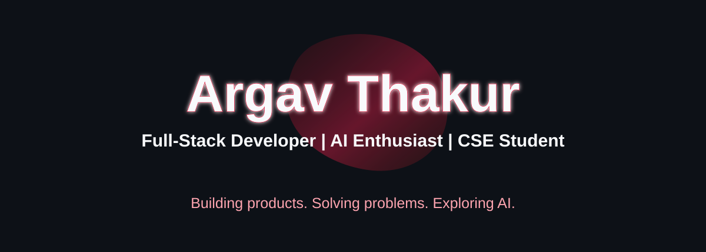

---

### `whoami`

I'm a **Computer Science undergraduate** interested in designing and building useful software, solving engineering problems, and exploring the practical applications of AI.

- Developing a strong foundation in **software development, data structures, and algorithms**.
- Building practical projects that turn ideas into working applications.
- Exploring AI and modern technologies with a focus on real-world use cases.
- Focused on writing clear, maintainable code and continuously improving through hands-on work.

### `tech_stack`

**Languages**

**Development Technologies**

**Databases & Tools**

### `selected_work`

| Project | What I'm building |
|---|---|
| **[Hostelers — Hostel Budget Manager](https://github.com/argavthakur-maker/Expense-tracker)** | A budgeting app for hostel students to track expenses, manage a monthly allowance, and make smarter day-to-day spending decisions. |
| **[DSA_CODES](https://github.com/argavthakur-maker/DSA_CODES)** | My C++ practice space for learning data structures, algorithms, and problem-solving step by step. |
| **[Portfolio](http://argav.vercel.app/)** | My developer portfolio and a home for the projects I'm working on. |

### `currently_learning`

- Data Structures & Algorithms — trees, BSTs, sorting, and problem solving
- Software engineering principles and application architecture
- Practical AI integrations and machine learning fundamentals

---

## 
📊 GitHub Analytics

<table>
<tr>
<td width="50%" align="center" valign="top">

### 🔥 GitHub Stats

</td>
<td width="50%" align="center" valign="top">

### 💻 Most Used Languages

</td>
</tr>
</table>

### ⚡ Contribution Streak

---

## 

**Consistency in code. Progress in every commit.**

Every commit is a small step forward — consistently learning, building, and improving.

---

### Always building. Always learning. 🚀

